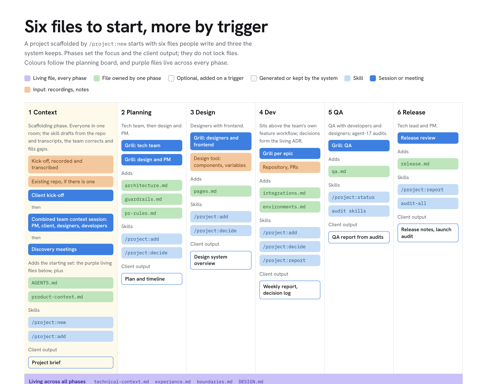
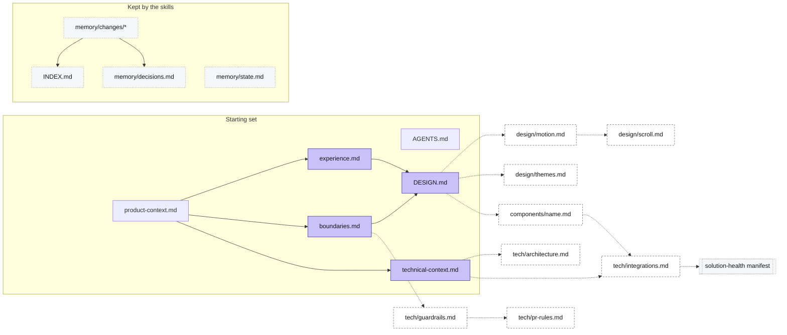

# File map

Every file the project skills manage, in the project's own repo.

The picture is the top of the interactive map, [artifacts/project-file-map.html](artifacts/project-file-map.html). GitHub shows an HTML file as source: download it and open it in a browser, or, with GitHub Pages turned on for this repo, open it at `/project/docs/artifacts/project-file-map.html` on the Pages site. Regenerate the picture when the map changes.

Kinds: **written** by people through the skills · **living**, written and updated in every phase · **optional**, added on a trigger · **generated** or kept by the skills.

Solid arrows: depends on. Dashed arrows: can grow into.

## Starting set

| File | Kind | Accountable | Added | Updated in |
|---|---|---|---|---|
| `AGENTS.md` | written | Tech lead | Context | Planning |
| `project/foundation/product-context.md` | written | PM | Context | Planning |
| `project/foundation/technical-context.md` | living | Tech lead | Context | every phase |
| `project/intent/experience.md` | living | Experience lead | Context | every phase |
| `project/intent/boundaries.md` | living | PM | Context | every phase |
| `project/building-blocks/DESIGN.md` | living | Designer | Context | every phase |
| `project/INDEX.md` | generated | script | Context | every change |
| `project/memory/state.md` | kept | skills | Context | every run |
| `project/memory/decisions.md` | kept | skills | Context | every decision |

## Optional files and their triggers

A written file is created only after the skill asks. Three kinds of trigger: something heard in an interview, transcript or prompt; a parent passing its size budget or a section getting its own owner; a proposal from the weekly dream.

| Parent | File | Trigger | Also changes |
|---|---|---|---|
| product-context | `foundation/glossary.md` | The first term two people use differently | |
| product-context | `foundation/stakeholders.md`, `foundation/kpis.md` | More than a handful of stakeholders; measurable targets agreed | The report reads the KPIs |
| technical-context | `tech/architecture.md` | Planning starts | |
| technical-context | `tech/data-model.md`, `tech/security.md`, `tech/performance.md` | A database or content model; auth or sensitive data; a performance budget | |
| technical-context | `tech/integrations.md` | Any external API, CMS, tracker or data source | solution-health manifest entry, proposed |
| technical-context | `tech/environments.md` | A second environment or a public URL | audit-launch, audit-infra, audit-security targets |
| experience | `intent/scenarios.md`, `intent/journeys/<name>.md`, `intent/audiences.md` | Real user questions; a multi-step flow; more than one audience | QA cases |
| boundaries | `intent/compliance.md` | GDPR, accessibility law or sector rules named | audit-privacy, audit-a11y cadence |
| boundaries | `tech/guardrails.md`, then `guardrails/code.md`, `design.md`, `ai.md` | Planning starts; split at the size budget or when owners differ | |
| guardrails | `tech/pr-rules.md` | Planning starts | |
| DESIGN.md | `design/motion.md` | Transitions, animation, micro-interactions | `motion:` tokens; reduced-motion rule in boundaries |
| DESIGN.md | `design/scroll.md` | Scroll storytelling, staggered reveals | Needs `motion.md` first |
| DESIGN.md | `design/themes.md` | Dark mode, high contrast, sub-brands | `light` and `dark` colour groups; QA per theme |
| DESIGN.md | `design/typography.md`, `design/layout.md` | Fluid type, variable fonts; grid, breakpoints, spacing rules | `typography:`, `spacing:` tokens |
| DESIGN.md | `design/iconography.md`, `design/imagery.md`, `design/voice.md`, `design/data-viz.md` | Icon set chosen; art direction; tone outgrows one section; charts in scope | |
| DESIGN.md | `design/accessibility.md` | A WCAG level or law named | audit-a11y cadence |
| building-blocks | `pages.md`, `pages/<template>.md` | First page template designed | |
| building-blocks | `components/<name>.md`, `components/<name>/.md` | A component designed or built; a part with its own rules | integrations, if it calls an API |
| tech | `tech/qa.md`, `qa/manual/<case>.md` | QA starts; a case a person must run by hand | Audit schedule |
| tech | `tech/release.md` | Release starts | audit-all |
| memory | `memory/timeline.md`, `memory/reports/<date>-<audience>.md` | Planning starts; each report run | |

## Generated, never written by hand

| File | Built from |
|---|---|
| `INDEX.md` | The file headers |
| `memory/CHANGELOG.md`, `memory/changelog/<file>.md`, each header's `version` | The change records |
| `tech/stack.md` | The package manifests |
| `building-blocks/components.md` | The component folder |
| `tokens/design.tokens.json`, the Tailwind 4 `@theme` file or custom properties | Whichever token source the project chose |
| Lint rules | Enforceable rules in `DESIGN.md` and the guardrails |
